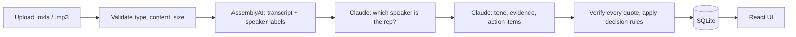

# Call Analyzer

A web app for sales managers to analyse customer calls. Upload a recording and the app transcribes it, separates the speakers, checks the **sales rep's tone** (RED or GREEN), and extracts **action items**. Every judgement is backed by quotes from the transcript, and everything is shown in one place.

- **Transcript** with speaker separation, timestamps, and a synced audio player
- **Tone check:** RED if the rep's tone is negative (rude, hostile, dismissive), otherwise GREEN, judged on the rep only, never the customer
- **Evidence:** verbatim quotes that link to the exact moment in the transcript and audio
- **Action items** with owner and deadline, shown as "Not specified" when the call doesn't say (never invented)
- **Configurable in the UI:** sensitivity, RED threshold, tone criteria, action item rules, custom instructions, and model, with no code changes
- **Re-analyse** with new settings without re-transcribing, with version history, a role swap, and a banner when your settings have changed since an analysis

<!-- Add screenshots here, e.g.  -->

## Contents

[Quick start](#quick-start) · [Try it without API keys](#try-it-without-api-keys) · [How it works](#how-it-works) · [Settings](#configuring-the-analysis) · [Configuration](#configuration) · [API](#api) · [Project structure](#project-structure) · [Testing](#testing) · [Cost and privacy](#cost-and-privacy) · [Design decisions](#design-decisions) · [Limitations](#known-limitations) · [Troubleshooting](#troubleshooting)

## Tech stack

| Layer | Choice | Why |
|---|---|---|
| Backend | Python, FastAPI, SQLAlchemy 2, SQLite | Strongest audio/AI ecosystem; Pydantic validates the model's structured output; zero-setup database |
| Transcription | AssemblyAI | Accepts `.m4a`/`.mp3` directly and returns speaker labels, timestamps, and confidence in one call |
| Analysis | Anthropic Claude (Haiku 5.5 by default, Sonnet 5.5 optional) via tool use | Schema-enforced JSON for tone, evidence, and action items |
| Frontend | React, TypeScript, Vite, Tailwind CSS v4, shadcn/ui | Fast to build a polished, accessible UI |
| State | Zustand (settings, UI) and TanStack Query (server state, polling) | Client state and server state kept separate |

## Quick start

### Prerequisites

- **Python 3.11 or 3.12**
- **Node.js** (current LTS, e.g. 22.x)
- An **[AssemblyAI](https://www.assemblyai.com/) API key** (new accounts get free credits)
- An **[Anthropic](https://console.anthropic.com/) API key** (needs a small prepaid balance)

No FFmpeg is needed: the transcription service accepts `.m4a` and `.mp3` directly.

### 1. Backend

From the repository root (PowerShell on Windows):

```powershell
cd backend
py -3.12 -m venv .venv
.venv\Scripts\Activate.ps1
pip install -r requirements.txt
copy .env.example .env
```

On macOS/Linux:

```bash
cd backend
python3 -m venv .venv
source .venv/bin/activate
pip install -r requirements.txt
cp .env.example .env
```

Open `backend/.env` and paste your two keys:

```
ASSEMBLYAI_API_KEY=your-key-here
ANTHROPIC_API_KEY=your-key-here
```

Start the server **from the `backend` folder**:

```bash
uvicorn app.main:app --reload --port 8000
```

Check it at <http://localhost:8000/api/health> (both keys should show as set). Interactive API docs are at <http://localhost:8000/docs>.

> **Windows tip:** if PowerShell refuses to activate the venv, run `Set-ExecutionPolicy -Scope CurrentUser RemoteSigned` once and try again.

### 2. Frontend

In a second terminal:

```bash
cd frontend
npm install
```

Create `frontend/.env.local` (copy `.env.local.example`):

```
VITE_API_URL=http://localhost:8000
VITE_USE_MOCK=false
```

```bash
npm run dev
```

Open <http://localhost:5173>, drop in a `.m4a` or `.mp3` call recording, and click **Analyse call**.

> Vite only reads `.env.local` at startup, so restart `npm run dev` after changing it. The page shows a banner if it can't reach the backend or if an API key is missing.

## Try it without API keys

The frontend ships with a scripted mock backend, so you can explore the whole UI (all states, settings, re-analysis, role swap, version history) without running the backend or spending anything.

Set `VITE_USE_MOCK=true` in `frontend/.env.local` and restart `npm run dev`. The **file name** you upload picks the scripted call (the file contents are ignored):

| File name contains | You get |
|---|---|
| `rude`, `red`, `angry` | A RED call: a dismissive rep with 4 evidence quotes |
| `review`, `unsure`, `swap` | A GREEN call that "needs review": wrong role guess, try **Swap roles** then re-analyse |
| `corrupt`, `fail`, `error` | Transcription failure |
| `ratelimit`, `retry` | Analysis fails once, then succeeds on retry |
| anything else | A clean GREEN call |

In the browser console, `mockControls.latencyMs = 2000` slows the fake network and `mockControls.failNextAnalysis = true` makes the next analysis fail.

## How it works



The upload returns immediately with a job ID. The frontend polls the job while it moves through `queued → transcribing → analysing → completed` (or `failed`), then shows the results.

### How accuracy is protected

The model **proposes**; the application's own code **decides**. Language models can fabricate quotes or overstate confidence, so nothing the model says is shown unchecked.

- **Quotes are verified.** Every tone quote and action-item quote must exist in the transcript. Matching ignores case and punctuation, tolerates the model citing the wrong line number, and accepts a near-match (about one changed word) by showing the real transcript line instead. Anything else is **dropped and reported** in the warnings.
- **RED needs proof.** A call is only RED if the model says the tone is negative, its confidence meets your threshold, **and** at least one verified quote from the **rep** supports it. Otherwise it is GREEN, flagged **Needs review**, with the reason.
- **The customer is never judged.** Quotes from the customer are rejected as tone evidence.
- **No invented owners or deadlines.** Owners are limited to rep, customer, or unknown. A deadline is kept only if its wording appears in the transcript near that line. Otherwise it is shown as "Not specified".
- **Uncertainty is shown, not hidden.** "Needs review" appears for low model confidence, low confidence about who the rep is, a suspected-but-unproven negative tone, non-English audio, or when no rep could be identified.
- **The transcript is treated as untrusted.** The prompt tells the model to ignore any instructions that appear inside a call, and your custom instructions are explicitly subordinate to the evidence rules.

### Who is the rep?

Speaker diarization only gives "Speaker A / Speaker B". A small first Claude call reads the opening and closing of the call and guesses the roles with a confidence. If it's wrong, **Swap roles** in the transcript header fixes it. Your choice is remembered across re-analyses, and the results page tells you when roles have changed since the last analysis.

## Configuring the analysis

Click **Settings** in the header. Changes save automatically in your browser and apply to new uploads and to re-analyses. Existing results don't change until you re-analyse.

| Setting | Options | Effect |
|---|---|---|
| Sensitivity | Lenient / Balanced / Strict | How readily mildly negative behaviour is flagged |
| RED threshold | 30%–95% | Minimum confidence required to mark a call RED |
| Tone criteria | Rudeness, hostility, dismissiveness, impatience, plus up to 6 of your own | Which behaviours count as negative; each definition is editable |
| Action item types | Commitments, follow-ups, information to send, meetings | What gets extracted (at least one required) |
| Customer commitments | Include / exclude | Whether the customer's promises are listed |
| Strictness | Concrete only / include loose follow-ups | Skips vague lines like "I'll keep you posted" |
| Custom instructions | Free text (1000 characters) | Extra context for the analysis |
| Model | Haiku 5.5 / Sonnet 5.5 | Cost versus nuance on borderline calls |

**Re-analyse** (on a call's page, from the Settings drawer or the banner) repeats only the analysis step. It doesn't re-transcribe, so it is fast and nearly free. Every run is kept in the **version history** with the exact settings it used, so you can compare results or load an old version's settings.

## Configuration

### Backend (`backend/.env`)

| Variable | Default | Notes |
|---|---|---|
| `ASSEMBLYAI_API_KEY` | none | Required |
| `ANTHROPIC_API_KEY` | none | Required |
| `SPEECH_MODELS` | `universal-3-pro,universal-2` | Comma-separated, in priority order. Change this if AssemblyAI rejects a model name |
| `MAX_UPLOAD_MB` | `100` | Upload size limit |
| `MAX_TRANSCRIPT_CHARS` | `250000` | Guard rail for very long calls (about 4 hours of speech) |
| `CORS_ORIGINS` | `["http://localhost:5173"]` | JSON list; update it if you serve the frontend elsewhere |
| `DATABASE_URL`, `UPLOAD_DIR` | under `backend/data/` | Where the SQLite file and uploaded audio live |

### Frontend (`frontend/.env.local`)

| Variable | Default | Notes |
|---|---|---|
| `VITE_API_URL` | `http://localhost:8000` | Backend address |
| `VITE_USE_MOCK` | `false` | `true` runs entirely on scripted demo data |

## API

Interactive documentation is generated at `/docs`.

| Method and path | Purpose |
|---|---|
| `GET /api/health` | Status, and whether each API key is set |
| `GET /api/settings/defaults` | The default analysis settings |
| `POST /api/jobs` | Upload (`multipart/form-data`: `file`, optional `settings` as a JSON string). Returns the job (201) immediately |
| `GET /api/jobs` | Recent jobs, newest first |
| `GET /api/jobs/{id}` | One job's status (what the UI polls) |
| `GET /api/jobs/{id}/result?version=N` | Transcript, speakers, tone, evidence, action items, warnings, and version list. Latest completed analysis unless `version` is given |
| `GET /api/jobs/{id}/audio` | The uploaded audio, for the player |
| `POST /api/jobs/{id}/reanalyse` | Body is the settings JSON. Re-runs only the analysis (202). `409` if the job is busy or has no transcript |
| `PUT /api/jobs/{id}/speakers` | Body `{"rep_label": "B"}`. Sets who the rep is; call `reanalyse` afterwards to apply it |
| `DELETE /api/jobs/{id}` | Delete a job and its audio |

Errors use FastAPI's `{"detail": "..."}` shape with meaningful messages (for example `415 Unsupported file type`, `413 File too large`).

## Database

SQLite, created automatically on first start.

| Table | Contents |
|---|---|
| `jobs` | One row per upload: file info, status, failure stage and message |
| `transcripts` | One per job (stored once, so re-analysis never re-transcribes) |
| `utterances` | One row per speaker turn, with timestamps and confidence. Quotes are verified against these |
| `speakers` | Diarization label to role (rep / customer / unknown), with confidence and whether it was set automatically or by you |
| `analyses` | One row per analysis run: version, model, the exact settings used (plus the roles used), tone, confidence, needs-review flag, warnings |
| `tone_evidence` | Verified quotes behind a tone verdict |
| `action_items` | Action items with nullable owner and deadline, plus the supporting quote |

## Project structure

```
backend/
  app/
    main.py, config.py, database.py, models.py, schemas.py
    routers/jobs.py            # HTTP endpoints
    services/
      pipeline.py              # background job: transcribe, then analyse
      transcription.py         # AssemblyAI
      analysis.py              # roles + Claude + persistence
      llm.py, llm_schemas.py   # Claude tool-use wrapper and output shapes
      prompts.py               # prompt construction from settings
      postprocess.py           # decision rules (RED/GREEN, owners, deadlines)
      verification.py          # quote verification
  tests/                       # pytest suite
frontend/
  src/
    api/                       # one interface, real HTTP client or mock
    components/                # upload, processing, results, settings, ui (shadcn)
    hooks/                     # TanStack Query hooks, transcript/audio interaction
    lib/                       # settings logic, formatting, diffing, helpers
    mocks/                     # scripted demo backend and fixtures
    pages/, store/, types/
```

## Testing

```bash
cd backend
pip install -r requirements-dev.txt
pytest
```

38 unit tests cover quote verification, the tone and action-item decision rules, role resolution, and prompt construction. They need no API keys and no network.

The frontend has no automated tests in this repository. Its core logic (settings handling, the mock API, the HTTP client) was exercised with throwaway scripts that are not included. Adding Vitest is listed under future work.

## Cost and privacy

**Cost** (approximate, as of November 2026; check each provider for current pricing):

| Item | Roughly |
|---|---|
| Transcription (AssemblyAI) | A few cents per 10-minute call; new accounts get free credits |
| Analysis with Haiku 5.5 | Around a tenth of a cent to a fifth of a cent per call |
| Analysis with Sonnet 5.5 | A couple of cents per call (roughly 10 to 20 times Haiku) |
| Re-analysis | Analysis cost only: no re-transcription |

**Privacy:** call audio is uploaded to **AssemblyAI** for transcription, and the transcript text is sent to **Anthropic** for analysis. Don't use recordings you aren't permitted to share with those services. Audio and results are stored locally in `backend/data/`.

## Design decisions

- **Two-step upload (select, then Analyse)** so you can check the settings that will apply before spending an analysis.
- **Transcript stored separately from analyses**, so re-analysis is cheap and every analysis is reproducible from its recorded settings.
- **The model never has the last word.** Verification and decision rules run in plain code, which is why they are unit-tested.
- **Red and green are reserved for the tone verdict.** Warnings and failures use amber, and processing uses blue, so a failed upload never looks like a RED call.
- **A single API interface** with a real client and a mock implementation, so the UI was built and tested before the backend was connected.
- **Structured output via tool use**, with no temperature or prefill settings, so it works across the supported Claude models.

## Known limitations

- **Single user, local only.** There is no authentication. Settings live in your browser's localStorage and are global across calls.
- **No database migrations.** Tables are created automatically. If you change the models, delete `backend/data/app.db` and restart.
- **Background work is in-process.** A server restart interrupts a running job; on startup it is marked failed and can be retried (from the saved transcript, if there is one).
- **Speaker separation is imperfect**, especially with overlapping speech or more than two speakers. That's why roles are editable.
- **English-tuned.** Other languages are flagged "Needs review".
- **Limits:** 100 MB per upload by default, and a transcript cap of about 4 hours of speech.
- **No upload progress bar**, since the browser `fetch` API doesn't report upload progress.
- **Audio seeking** relies on the backend serving byte ranges. If clicking a quote doesn't jump to the right moment in your setup, check that first.
- **The AssemblyAI Python SDK** describes itself as intended for testing and light usage, which suits this scope but not production scale.
- **Mock code is included in the frontend bundle.** Harmless here, but you'd split it out for production.

**Future work:** Docker Compose, Vitest and Playwright tests, a tone indicator in the history list, a proper queue for background jobs, authentication, and deployment.

## Troubleshooting

| Symptom | Fix |
|---|---|
| Banner: "Can't reach the backend" | Start the backend (`uvicorn app.main:app --reload --port 8000` from `backend/`). The page rechecks every few seconds |
| Banner: "API key missing" | Add the key to `backend/.env` and restart the backend |
| Upload fails with an AssemblyAI model error | Set `SPEECH_MODELS` in `backend/.env` to a model name your account supports |
| "credit balance too low" | Add credit in the Anthropic console |
| Browser console shows a CORS error | Make sure the frontend runs on a URL listed in `CORS_ORIGINS` |
| `npm run dev` says port 5173 is in use | Close the other dev server. The port is fixed on purpose so it matches the CORS setting |
| Errors after pulling a newer version | Delete `backend/data/app.db` and restart (no migrations, see above) |
| PowerShell won't activate the venv | `Set-ExecutionPolicy -Scope CurrentUser RemoteSigned` |

## How this maps to the brief

| Requirement | Where it lives |
|---|---|
| Upload `.m4a`, transcript, speakers | `services/transcription.py`, transcript panel with a synced audio player |
| Tone RED/GREEN on the rep only | `services/postprocess.py`, tone card |
| Action items, no invented owners or deadlines | `services/postprocess.py`, action items card |
| Evidence, uncertainty, error handling | `services/verification.py`, "Needs review" and warnings, failed-job recovery |
| Configurability in the UI | Settings drawer, re-analysis, version history |
